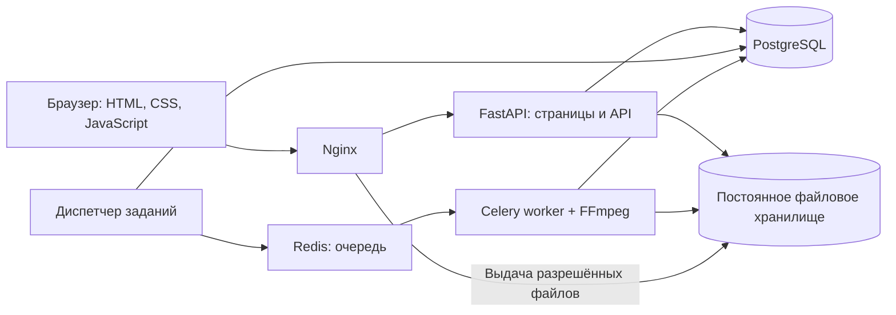

> Исторический план до упрощения от 2026-11-03. Актуальные принятые решения:
> [docs/architecture.md](docs/architecture.md), постоянные инструкции — [AGENTS.md](AGENTS.md).
> Redis, Celery, диспетчер, HLS и вход до 4K ниже заменены очередью PostgreSQL,
> одним MP4 до 720p и входом до 1080p. Архивная матрица приёмки ниже неактуальна;
> текущая находится в [docs/testing.md](docs/testing.md).

# FoxTube — исторический план разработки на FastAPI и PostgreSQL

Разработать законченное приложение по [TestTask.md](TestTask.md), в котором можно зарегистрироваться, загрузить видео, дождаться обработки, посмотреть его, поставить лайк и оставить комментарий.

Обязательные условия: **Python + FastAPI, PostgreSQL, Swagger на `/docs`, простой фронт**. Согласованные ориентиры: один сервер с 4 CPU и 8 ГБ RAM, адаптивный интерфейс, близкий к YouTube, русский язык, выдача доступа к приватным видео конкретным зарегистрированным пользователям.

## 1. Архитектура и технологический стек

### Общая архитектура

Основа — **модульный монолит FastAPI с отдельным процессом обработки видео**. HTML-страницы и JSON API используют одни сервисы и правила доступа. Обработка через FFmpeg выполняется независимо от веб-приложения.



Основные процессы:

- **Приложение:** авторизация, страницы, API, бизнес-правила и проверка доступа.
- **Worker:** проверка файлов, создание превью, преобразование видео в HLS.
- **Диспетчер:** отправка сохранённых заданий в очередь и восстановление зависших задач.
- **Nginx:** единая точка входа, статические ресурсы, ограничения запросов и раздача медиа.
- **PostgreSQL:** пользователи, видео, взаимодействия, права и состояние заданий.
- **Redis:** доставка фоновых задач.

### Стек

| Область | Решение | Назначение |
|---|---|---|
| Backend | Python 3.12, FastAPI, Pydantic 2, Uvicorn | Типизированные API, валидация, OpenAPI |
| База данных | PostgreSQL 17 | Транзакции, ограничения целостности, поиск |
| Работа с БД | SQLAlchemy 2, psycopg 3, Alembic | Модели, запросы, миграции |
| Фронт | Jinja2, CSS, обычный JavaScript | Серверный HTML с интерактивными элементами |
| Плеер | HTML5 Video, HLS.js | Воспроизведение и переключение качества |
| Обработка | FFmpeg и ffprobe | Проверка видео, перекодирование, превью |
| Фоновые задачи | Celery 5.6, Redis | Независимая обработка с повторными попытками |
| Хранилище | Постоянный Docker volume | Исходники, результаты обработки, временные файлы |
| Развёртывание | Docker Compose, Nginx, стартовый скрипт | Запуск всех компонентов одной командой |
| Проверки | pytest, HTTPX, Playwright для Python | Модульные, интеграционные и браузерные тесты |

Jinja2 позволяет оставить фронт простым и обслуживать страницы непосредственно из FastAPI. JavaScript потребуется для загрузки с прогрессом, плеера и действий без перезагрузки страницы. [Документация FastAPI по шаблонам](https://fastapi.tiangolo.com/advanced/templates/).

Для SQLAlchemy использовать синхронные сессии: отдельная сессия на запрос или фоновую задачу, короткие транзакции. Обработчики с блокирующими операциями выполняются вне основного цикла асинхронных запросов.

Версии Python-зависимостей фиксировать в lock-файле, контейнеров — конкретными версиями и digest.

### Границы первой версии

Включить все экраны и функции задания, управление собственными видео и плейлистами, выдачу и отзыв приватного доступа, работу модератора и администратора.

Для первой версии выбрать локальное файловое хранилище: оно соответствует согласованному размещению на одном сервере. Доступ к нему оформить отдельным компонентом `Storage`, чтобы бизнес-логика не зависела от физических путей.

Прямые эфиры, Shorts, монетизацию, рекомендательную модель, почтовые приглашения и распределённое развёртывание оставить за пределами первой версии.

## 2. Модель данных и жизненный цикл видео

### Основные сущности

| Сущности | Основные данные и связи |
|---|---|
| `users`, `sessions` | Аккаунт, нормализованный email, хеш пароля, роль; серверные сессии и срок действия |
| `channels` | Один канал на пользователя: название, уникальный адрес, описание |
| `videos` | Владелец, канал, название, описание, видимость, состояние обработки, состояние модерации, технические характеристики |
| `video_assets` | Файлы исходника, превью, HLS-плейлистов и сегментов; внутренний ключ хранения и размер |
| `video_grants` | Разрешение конкретному пользователю смотреть конкретное приватное видео |
| `likes`, `comments`, `subscriptions` | Реакции, комментарии и подписки на каналы |
| `playlists`, `playlist_items` | Плейлист автора и упорядоченный список видео |
| `reports`, `audit_events` | Жалобы, решения модераторов, изменения ролей и прав доступа |
| `processing_jobs` | Состояние обработки, попытки, время запуска, heartbeat и сведения об ошибке |

Важные решения:

- Использовать UUID, внешние ключи и временные отметки с часовым поясом.
- Уникальность email, адреса канала, лайка, подписки и разрешения закрепить ограничениями БД.
- Запретить повторное добавление одного видео в один плейлист.
- Индексировать ленту, видео канала, комментарии, открытые жалобы и необработанные задания.
- Поиск выполнять по названию через `ILIKE`, с GIN-индексом `pg_trgm`. Расширение поддерживает индексирование таких запросов. [Документация PostgreSQL](https://www.postgresql.org/docs/17/pgtrgm.html).
- Счётчики лайков, комментариев и подписчиков получать из реальных записей.
- Удаление видео сначала помечать в БД и сразу запрещать просмотр; физическую очистку выполнять фоновым заданием.

**Обработка, приватность и модерация — независимые состояния.** Завершившаяся обработка не должна публиковать приватное видео или восстанавливать скрытое модератором.

### Загрузка и обработка

Состояния обработки:

```text
UPLOADING → QUEUED → PROCESSING → READY
                          └──→ FAILED
```

Последовательность:

1. Автор заполняет название, описание и видимость. API создаёт черновик.
2. Браузер передаёт файл и показывает фактический прогресс отправки через `XMLHttpRequest`.
3. API принимает файл с ограничением размера и сохраняет во временный каталог. Большой файл не загружается целиком в RAM.
4. После успешной записи файл атомарно переносится в каталог исходников. В одной транзакции сохраняются состояние `QUEUED` и запись фонового задания.
5. Диспетчер передаёт идентификатор задания в Celery.
6. Worker проверяет файл через ffprobe и запускает FFmpeg.
7. Готовые файлы проверяются, публикуются атомарно; только затем видео получает `READY`.
8. Страница загрузки опрашивает состояние и показывает результат либо понятную ошибку.

Для файлов использовать `UploadFile`, который поддерживает временное хранение на диске. Тяжёлую обработку вынести в Celery — такой подход предусмотрен и рекомендациями FastAPI. [Загрузка файлов](https://fastapi.tiangolo.com/tutorial/request-files/), [фоновые вычисления](https://fastapi.tiangolo.com/tutorial/background-tasks/).

Начальные ограничения:

- Контейнеры MP4, MOV и WebM с поддерживаемым FFmpeg видеопотоком.
- До 500 МиБ и 20 минут на видео.
- Исходное разрешение до 3840 × 2160.
- Выход: HLS с H.264/AAC, варианты до 360p и 720p.
- Сохранять пропорции и ориентацию; не увеличивать исходное разрешение.
- Поддерживать видео без звука.
- Генерировать превью из самого видео.
- Одна одновременная задача перекодирования, до двух потоков FFmpeg.

Прогресс отправки файла и прогресс обработки показывать отдельно. Отправленные 100% ещё не означают готовность к просмотру.

### Надёжность конвейера

PostgreSQL хранит окончательное состояние задания; Redis используется для доставки. Это закрывает сбой между записью видео в БД и отправкой сообщения в очередь.

- Диспетчер повторно отправляет задания, которые не были приняты worker.
- Worker блокирует параллельную обработку одного задания и обновляет heartbeat.
- Повторный запуск не создаёт дубли и не повреждает опубликованные файлы.
- Каждая попытка пишет результаты в собственный временный каталог.
- Для временных ошибок — до трёх попыток; повреждённый или неподдерживаемый файл завершается ошибкой без бессмысленных повторов.
- Зависшие задания восстанавливаются после истечения блокировки.
- Незавершённые загрузки и временные файлы очищаются автоматически.

## 3. Экраны, API и безопасность

### Простой фронт с компоновкой YouTube

Использовать светлую тему, бренд FoxTube, закреплённую верхнюю панель, поиск, боковую навигацию и карточки с превью 16:9. На узком экране меню сворачивается, сетка перестраивается, блок рекомендаций перемещается под видео.

| Экран | Поведение |
|---|---|
| Главная `/` | Лента готовых публичных видео, пагинация, переключение на видео подписок |
| Просмотр `/watch/{id}` | Плеер, качество, название, описание, канал, подписка, лайк, комментарии, жалоба, список других публичных видео |
| Канал `/channels/{handle}` | Шапка автора, подписка, вкладки видео и плейлистов |
| Плейлист `/playlists/{id}` | Упорядоченные доступные видео и переход к воспроизведению |
| Поиск `/search?q=...` | Поиск по названию, результаты и состояние «ничего не найдено» |
| Загрузка `/upload` | Файл, метаданные, видимость, два вида прогресса, ошибки, список собственных загрузок |
| Вход и регистрация | Валидация, понятные ошибки, возврат к исходному действию после входа |
| Модерация `/moderation` | Жалобы, причины, скрытие, восстановление и история решений |
| Управление доступом | Панель владельца: выдача доступа по точному email существующего аккаунта и отзыв разрешения |

Управление собственными плейлистами разместить на странице своего канала. Управление ролями — в разделе администратора.

Для всех экранов предусмотреть пустые состояния, ошибки и отсутствие доступа. Все отображаемые кнопки должны выполнять действие. Неподдерживаемые функции YouTube в интерфейс не добавлять.

### API и Swagger

JSON API разместить под `/api/v1`. Основные группы:

| Группа | Операции |
|---|---|
| Авторизация | Регистрация, вход, выход, текущий пользователь, получение CSRF-токена |
| Видео | Лента, поиск, карточка, создание черновика, загрузка исходника, состояние обработки, изменение и удаление |
| Медиа | Выдача превью, HLS-плейлистов и сегментов после проверки прав |
| Приватный доступ | Список разрешений, выдача и отзыв владельцем |
| Социальные действия | Установка и удаление лайка, комментарии, подписка и отписка |
| Каналы и плейлисты | Просмотр, редактирование собственного канала, управление плейлистами |
| Модерация | Создание и рассмотрение жалоб, скрытие и восстановление |
| Администрирование | Изменение ролей с записью в аудит |

Лайки и подписки реализовать идемпотентными операциями установки/удаления, чтобы повторный запрос не менял результат неожиданным образом.

На `/docs` должны работать описания, примеры, загрузка файлов и `Try it out`. Cookie-аутентификация и передача CSRF-токена настраиваются также для Swagger. Его ресурсы и HLS.js поставлять локально, без обязательного обращения к CDN. [Локальные ресурсы Swagger в FastAPI](https://fastapi.tiangolo.com/how-to/custom-docs-ui-assets/).

### Роли и приватность

| Участник | Права |
|---|---|
| Гость | Просмотр публичных готовых видео, каналов и публичного поиска |
| Пользователь | Загрузка, лайки, комментарии, подписки, жалобы; просмотр разрешённых приватных видео |
| Владелец видео | Изменение своих видео, управление доступом и собственными плейлистами |
| Модератор | Рассмотрение жалоб, скрытие и восстановление видео |
| Администратор | Права модератора и управление ролями |

Роль модератора или администратора сама по себе **не даёт просмотра приватного видео**: действует требование разрешения владельца. Для модерации без такого разрешения доступны сведения о жалобе и действия со статусом видео.

Все проверки сосредоточить в общем компоненте политик доступа:

- В публичную ленту и поиск попадают только публичные, готовые, нескрытые видео.
- Каналы, плейлисты, обложки и счётчики не раскрывают недоступные пользователю видео.
- Получение комментариев и взаимодействие с видео также требуют права просмотра.
- Скрытое или удалённое видео перестаёт воспроизводиться независимо от ранее выданных разрешений.
- Восстановление модератором сохраняет исходную приватность.

### Защита медиа

Каждый запрос превью, HLS-плейлиста и сегмента проходит проверку FastAPI. При успехе приложение передаёт выдачу файла Nginx через `X-Accel-Redirect` во внутренний каталог. Такой каталог недоступен прямым внешним запросом. [Документация Nginx](https://nginx.org/en/docs/http/ngx_http_core_module.html#internal).

Дополнительно:

- Исходники не имеют публичных URL.
- Пути строятся по внутренним идентификаторам, без использования имени загруженного файла.
- Проверки распространяются на `GET`, `HEAD` и запросы диапазонов.
- В первой версии отключается кеширование медиа, способное обойти повторную проверку прав.
- Отзыв доступа действует со следующего запроса; уже загруженные в браузер данные технически не отзываются.

### Остальная безопасность

- Пароли — Argon2id; сессии — случайные непрозрачные токены, в БД хранятся их хеши. [Рекомендации OWASP](https://cheatsheetseries.owasp.org/cheatsheets/Password_Storage_Cheat_Sheet.html).
- Cookie: `HttpOnly`, `SameSite`, `Secure` при HTTPS; ротация сессии при входе и отзыв при выходе.
- Для изменяющих запросов — CSRF-токен и проверка источника запроса.
- Регистрация всегда создаёт обычного пользователя; роль и владельца нельзя назначить клиентским запросом.
- Ограничения частоты входа, регистрации, загрузок и жалоб.
- Экранирование пользовательского текста, ограничение длины полей, параметризованные SQL-запросы.
- FFmpeg запускается без shell, с ограничениями времени и ресурсов и запретом сетевых источников.
- БД и Redis не публикуют порты наружу; приложение и worker работают без root.
- Проверять доступное место и квоты, корректно завершать загрузку при переполнении.
- Изменения ролей, разрешений и решения модерации записывать в аудит.

## 4. Структура проекта и этапы разработки

### Структура

```text
FoxTube/
├── app/
│   ├── main.py
│   ├── core/                  # настройки, безопасность, ошибки
│   ├── modules/
│   │   ├── auth/
│   │   ├── channels/
│   │   ├── videos/            # каталог, загрузка, права доступа
│   │   ├── social/            # лайки, комментарии, подписки
│   │   ├── playlists/
│   │   └── moderation/
│   ├── infrastructure/        # БД, файловое хранилище, очередь
│   ├── processing/            # FFmpeg, задачи, диспетчер
│   └── web/
│       ├── routes/
│       ├── templates/
│       └── static/            # CSS, JavaScript, локальные библиотеки
├── migrations/
├── tests/
│   ├── unit/
│   ├── integration/
│   ├── e2e/
│   └── fixtures/
├── scripts/                   # bootstrap, seed, smoke, упаковка
├── deploy/                    # конфигурация Nginx
├── docs/                      # архитектура, БД, безопасность, приёмка
├── Dockerfile
├── compose.yaml
├── pyproject.toml
├── uv.lock
├── .env.example
└── README.md
```

Внутри функционального модуля разделять маршруты, Pydantic-схемы, модели, запросы к БД и сервисы. Маршруты отвечают за HTTP; сервисы — за бизнес-правила и транзакции. HTML и API обращаются к одним сервисам.

### Последовательность разработки

| Этап | Результат и условие завершения |
|---|---|
| **1. Каркас и инфраструктура** | Конфигурация, Compose, PostgreSQL, Redis, Nginx, миграции, `/docs`, проверки готовности; пустое приложение запускается на Ubuntu |
| **2. Пользователи и доступ** | Регистрация, сессии, роли, создание канала, политики доступа; проверена матрица разрешений |
| **3. Полный видеоконвейер** | Загрузка → очередь → FFmpeg → HLS → реальное воспроизведение, включая приватное видео |
| **4. Основные экраны** | Главная, просмотр, канал, поиск, загрузка и авторизация; адаптивность и все состояния |
| **5. Взаимодействия** | Лайки, комментарии, подписки, плейлисты, управление приватным доступом |
| **6. Модерация и восстановление** | Жалобы, скрытие, роли, аудит; восстановление после сбоев worker и очереди |
| **7. Приёмка и упаковка** | Полный набор проверок, демо-данные, визуальная доводка, документация и финальный архив |

Путь реального видео проверить на третьем этапе: остальные экраны и социальные функции должны опираться на уже работающую загрузку и выдачу.

## 5. Развёртывание, тесты и критерии приёмки

### Одна команда на чистой Ubuntu

После распаковки архива:

```bash
sudo bash scripts/bootstrap.sh --demo
```

Целевое окружение: **Ubuntu 24.04 LTS, 4 CPU, 8 ГБ RAM, от 40 ГБ свободного диска**, доступ к интернету для первоначальной установки.

Стартовый скрипт должен:

1. Проверить окружение, свободное место и занятые порты.
2. При отсутствии установить Docker Engine и Compose из официального репозитория.
3. Создать конфигурацию и случайные секреты.
4. Подготовить постоянные тома и права на каталоги.
5. Запустить БД и очередь, дождаться их готовности.
6. Выполнить миграции отдельным завершаемым процессом.
7. Запустить приложение, worker, диспетчер и Nginx.
8. Заполнить демо-данные и дождаться готовности демо-видео.
9. Выполнить smoke-проверку и вывести адрес приложения, `/docs` и доступы к демо-аккаунтам.

Порядок запуска связывать с healthcheck и успешным завершением миграций: сам факт запуска контейнера не означает готовности сервиса. [Документация Docker Compose](https://docs.docker.com/compose/how-tos/startup-order/).

Повторный запуск сохраняет данные и секреты, не создаёт дубли. Перезапуск контейнеров сохраняет аккаунты, видео, комментарии и незавершённые задания.

По умолчанию команда запускает проверочное HTTP-окружение без обязательного домена. Для внешнего размещения документируется HTTPS-конфигурация и безопасные cookie.

### Демо-данные и документация

Идемпотентный seed создаёт:

- Шесть аккаунтов, включая администратора, модератора, авторов и зрителей с разными правами.
- Двенадцать видео, включая публичные, приватные и скрытые.
- Плейлисты, подписки, лайки, комментарии и жалобы.
- Настоящие короткие видеофайлы, проходящие обычный конвейер обработки.

Использовать включённые в проект или генерируемые FFmpeg материалы с понятным происхождением. Демонстрация не зависит от сторонних видеоссылок. Пароли привилегированных аккаунтов генерируются при развёртывании.

В поставку включить:

- **README:** запуск одной командой, демо-сценарий, команды проверки, ограничения и устранение типичных ошибок.
- **docs/:** схема компонентов, ER-диаграмма, видеоконвейер, матрица доступа, безопасность, развёртывание, резервное копирование и восстановление.
- **Сценарий приёмки:** последовательные действия проверяющего и ожидаемые результаты.
- Исходники, миграции, lock-файл, конфигурации, автотесты и seed.
- Архив без секретов, локальных кешей и случайных пользовательских файлов.

### Матрица соответствия заданию

| Критерий | Что считается выполнением |
|---|---|
| **Сходство с YouTube** | Узнаваемые верхняя панель, поиск, меню, сетка карточек, страница просмотра и канал; проверка компоновки на 1440 × 900 и 390 × 844 |
| **Разворачиваемость** | На новой Ubuntu без Docker выполняется одна команда, после которой доступны приложение, `/docs`, БД, хранилище и обработка |
| **Основной сценарий** | Новый пользователь регистрируется, загружает настоящий файл, дожидается готовности, воспроизводит его, ставит лайк и оставляет комментарий |
| **Загрузка, хранение и выдача** | Видео преобразуется в HLS, воспроизводится с перемоткой; файлы сохраняются после перезапуска |
| **Архитектура** | Разделены HTTP, бизнес-правила, хранение и обработка; документированы взаимодействия и восстановление заданий |
| **Проектирование БД** | Схема разворачивается миграциями; ограничения предотвращают дубли и нарушение связей; основные запросы индексированы |
| **Безопасность** | Нельзя изменить чужое видео, повысить роль, обойти приватность прямой ссылкой или продолжить получать сегменты после отзыва доступа |
| **Комплектность** | Архив содержит README, docs/, автотесты и воспроизводимый seed с реальными видео |

### Автоматические проверки

**Модульные:** матрица доступа, переходы состояний, ограничения файлов, идемпотентность действий и повторной обработки.

**Интеграционные:** настоящие PostgreSQL и Redis, миграции с нуля, ограничения БД, поиск, отсутствие утечек приватных видео, выдача медиа через Nginx.

**Браузерные:** регистрация → загрузка → ожидание обработки → фактическое воспроизведение → лайк → комментарий. Проверять движение времени плеера и перемотку, а также канал, подписку, плейлист и мобильную компоновку.

**Негативные и аварийные сценарии:**

- Гость и посторонний аккаунт запрашивают приватные метаданные, превью, манифест и отдельный сегмент.
- Владелец отзывает разрешение после начала просмотра.
- Модератор скрывает видео; завершение обработки не возвращает его в публикацию.
- Загружаются повреждённый, слишком большой файл и видео без звука.
- Пользователь отменяет передачу; временные файлы очищаются.
- Worker останавливается во время обработки и затем запускается снова.
- Redis перезапускается; задания восстанавливаются из состояния PostgreSQL.
- Повторный bootstrap и seed сохраняют существующие данные.
- Весь комплект устанавливается на отдельной чистой виртуальной машине Ubuntu.

Финальная готовность определяется прохождением этой матрицы на собранном архиве, включая настоящее воспроизведение и проверку приватности на уровне файлов.
